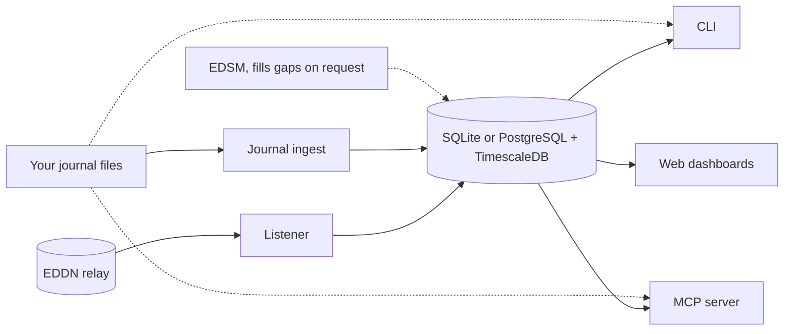

# 🚀 elite-helper

**Your own Elite Dangerous data service:** live market and faction data from EDDN, your journal history, ship build
maths and live web dashboards, available from a command line and from Claude through MCP.


[](https://github.com/EDCD/EDDN)

[Features](#-features) · [Quick start](#-quick-start) · [CLI](#-cli) · [Finding systems](#-finding-systems) ·
[Journals](#-your-journals) · [Ship builds](#-ship-builds) · [Dashboards](#-dashboards) · [MCP](#-mcp-server) ·
[Running it](#-running-it) · [Reference](#-reference) · [Limitations](#-limitations) · [Tests](#-tests)

---

## ✨ Features

| | Feature | What you get |
|---|---|---|
| 📡 | **EDDN listener** | Collects station markets and system faction data as players upload them |
| 📈 | **Time series** | Price, stock, demand, influence and faction state history, plus how often each place is reported |
| 🔎 | **Search** | Best places to buy or sell, trade pairs, and systems by economy, faction state, distance and more |
| 🧾 | **Journal tools** | Where you are, credits per hour, travel, ledger, cargo, materials, ships and missions |
| 🛠️ | **Ship builds** | Jump range, power priorities, what still fits, jump and cargo optimisers |
| 🖥️ | **Live dashboards** | A faction state watch (**Recce**) and a community goal **supply board** on `127.0.0.1` |
| 🤖 | **MCP server** | All of the above as tools for Claude |



> [!IMPORTANT]
> EDDN is a live feed with **no history**. You only have data that players uploaded while your listener was running, so
> every result carries its **age**. `--live` (CLI) and `live_lookup` (MCP) fetch a missing or stale system or station
> from [EDSM](https://www.edsm.net).

## ⚡ Quick start

**You need:** Windows, [Git](https://git-scm.com), [uv](https://docs.astral.sh/uv/) and Python 3.11 or newer. SQLite
works out of the box; [PostgreSQL with TimescaleDB](#postgresql--timescaledb) is optional and recommended for long
running collection. Run every command from the repository folder, in PowerShell.

**1. Clone**

```powershell
git clone https://github.com/Abhi-Sutar/elite-helper.git
```

```powershell
cd elite-helper
```

**2. Install** (creates `.venv` from `pyproject.toml` and `uv.lock`)

```powershell
uv sync
```

**3. Start collecting** (leave it running)

```powershell
.venv\Scripts\python.exe -m eddn_helper listen
```

**4. In a second window, check that data is arriving**

```powershell
.venv\Scripts\python.exe -m eddn_helper status
```

**5. Ask something**

```powershell
.venv\Scripts\python.exe -m eddn_helper commodity gold --sell --near Sol --ly 100
```

**6. Open the live dashboard** (the default one centres on your current system, taken from your journal)

```powershell
scripts\elite-dash open
```

> [!NOTE]
> The database is `--db <url-or-path>`, else `ELITE_HELPER_DATABASE_URL`, else
> `%LOCALAPPDATA%\elite-helper\elite.sqlite`. `--db` goes **before** the command. Only one listener can run per database
> (an OS file lock); a second one exits and prints the first one's PID.

## 💻 CLI

The form is `python -m eddn_helper [--db DB] <command>`. Commands that report data accept `--json`, and every command
explains its options with `--help`.

```powershell
.venv\Scripts\python.exe -m eddn_helper --help
```

| Group | Commands |
|---|---|
| 🏪 Markets | `market` `price-history` `commodity` `trades` `traffic` `busiest` `activity` |
| 🌌 Systems and factions | `system` `factions` `timeline` `faction` `economy` `find-systems` `faction-stations` `refresh-stations` `refresh-factions` |
| 🧾 Journal | `where` `credit-rate` `history` `travel` `visited` `sessions` `ledger` `cargo` `materials` `ships` `missions` `ranks` `stats` `carrier` `journal-sync` `journal-status` |
| 🛠️ Ship builds | `build-show` `build-suggest` `build-priorities` `build-jump` `build-check` `build-max-cargo` `build-data` |
| ⚙️ Maintenance | `listen` `status` `migrate` `backup` `copy-data` `import-legacy` `prune` |

### 🏪 Markets and trading

`Buy` is what **you pay** the station (needs stock). `Sell` is what the station **pays you** (needs demand).

```powershell
.venv\Scripts\python.exe -m eddn_helper market Daedalus --system Sol --live
```

```powershell
.venv\Scripts\python.exe -m eddn_helper commodity gold --sell --near Sol --ly 100 --min-amount 500 --no-carriers
```

```powershell
.venv\Scripts\python.exe -m eddn_helper commodity "liquid oxygen" --buy --limit 5
```

```powershell
.venv\Scripts\python.exe -m eddn_helper trades Sol --ly 40 --cargo 256
```

**History and traffic**

```powershell
.venv\Scripts\python.exe -m eddn_helper price-history Daedalus gold --system Sol --days 14 --bucket 60
```

```powershell
.venv\Scripts\python.exe -m eddn_helper price-history N0B-T4X all --days 7 --csv > carrier.csv
```

```powershell
.venv\Scripts\python.exe -m eddn_helper price-history N0B-T4X gold --resample 60
```

```powershell
.venv\Scripts\python.exe -m eddn_helper traffic N0B-T4X --days 7 --bucket 60
```

```powershell
.venv\Scripts\python.exe -m eddn_helper traffic Sol --systems
```

```powershell
.venv\Scripts\python.exe -m eddn_helper busiest --days 1 --limit 20 --no-carriers
```

```powershell
.venv\Scripts\python.exe -m eddn_helper activity N0B-T4X
```

### 🌌 Systems and factions

```powershell
.venv\Scripts\python.exe -m eddn_helper system Sol --live
```

```powershell
.venv\Scripts\python.exe -m eddn_helper factions Sol --history 14 --faction "Mother Gaia"
```

```powershell
.venv\Scripts\python.exe -m eddn_helper timeline Sol "Mother Gaia" --days 30 --csv
```

```powershell
.venv\Scripts\python.exe -m eddn_helper faction "Mother Gaia"
```

```powershell
.venv\Scripts\python.exe -m eddn_helper economy Sol --live
```

```powershell
.venv\Scripts\python.exe -m eddn_helper faction-stations "Mother Gaia"
```

```powershell
.venv\Scripts\python.exe -m eddn_helper refresh-stations Sol
```

## 🔭 Finding systems

`find-systems` (MCP: `find_systems`) returns systems matching **all** criteria, nearest to `--near` first (otherwise
most populated first). Add `--csv` or `--json` to export.

**Extraction, Refinery or Industrial systems with a faction in Expansion, near Sol**

```powershell
.venv\Scripts\python.exe -m eddn_helper find-systems --economy Extraction,Refinery,Industrial --state Expansion --near Sol --ly 40
```

**Agricultural or industrial, pending Expansion, with no extraction or refinery economy anywhere**

```powershell
.venv\Scripts\python.exe -m eddn_helper find-systems --economy Agri,Industrial --state Expansion --state-in pending --exclude-economy Extraction,Refinery --near Sol --ly 60
```

**Million-plus industrial systems whose controlling player faction began expanding in the last two days**

```powershell
.venv\Scripts\python.exe -m eddn_helper find-systems --economy Industrial --min-pop 1000000 --controlling-only --player-faction yes --state Expansion --state-in active --state-since-hours 48 --refresh-stations
```

**Pending Expansion in an extraction system that also wants Bertrandite or Coltan**

```powershell
.venv\Scripts\python.exe -m eddn_helper find-systems --state Expansion --state-in pending --economy Extraction --demand bertrandite,coltan
```

<details>
<summary><b>All filter options</b></summary>

| Option | Meaning |
|---|---|
| `--economy A,B` | any of these; case and space insensitive (`High Tech` = `HighTech`, `Agriculture` = `Agri`) |
| `--economy-scope system\|station\|any` | system economy (default, plus the second economy unless `--no-second`), any station's economy, or either |
| `--state X --state-in any\|state\|active\|pending\|recovering` | a faction has state X as its main state, in its active, pending or recovering list, or anywhere (default `any`); `--controlling-only` limits it to the controlling faction |
| `--near SYSTEM --ly N`, `--min-pop N`, `--max-pop N`, `--max-age-hours N` | distance, population and data age filters |
| `--demand a,b` | a station currently has demand for any of these commodities |
| `--exclude-economy A,B`, `--exclude-scope any\|system\|station` | reject a system whose economy, second economy or (scope `any` or `station`) any station's economy is one of these; "not at all" is the default |
| `--exclude-state X,Y`, `--exclude-state-in ...` | reject systems where **any** faction has one of these states (e.g. `War,CivilWar`) |
| `--exclude-system A,B` | drop named systems |
| `--allegiance`, `--government`, `--security` | any-of lists, e.g. `--government Democracy,Corporate --security low,anarchy` |
| `--conflict yes\|no`, `--conflict-type War,CivilWar,Election` | systems with or without an active conflict, and of which type |
| `--faction NAME`, `--min-influence N`, `--max-influence N`, `--happiness A,B`, `--trend N` | criteria on the **same** faction as `--state` (influence in percent; `--trend` is the raw number stored for pending and recovering states) |
| `--player-faction yes\|no` | the matching faction is or is not a player faction (see below) |
| `--state-since-hours N` | with `--state`: the faction's **current run** of that state began within N hours. Worked out from stored faction history; each hit shows when it began, with "or earlier" when history starts inside the run |
| `--min-stations N`, `--station-type coriolis,outpost` | at least N stations with a stored market; a station type containing one of the names |
| `--sort distance\|population\|influence\|freshest\|name` | ordering (default distance; most populated first without `--near`) |

</details>

<details>
<summary><b>Player factions and fetching what is missing</b></summary>

EDDN does not say whether a faction is a player faction, so this comes from [EDSM](https://www.edsm.net) (stored by
`refresh-stations`, `--refresh-stations` or a `--live` lookup). Factions EDSM has not been asked about are **kept** and
shown as `[?]` (`[P]` = player); the reply counts them in `faction_players_unknown`. EDSM is asked one system at a time,
at 1 request per second.

- `find-systems ... --refresh-players --refresh-limit N` fetches **only** the player status of the matching factions
  (one request per system; a faction controlling several result systems is looked up once). `--refresh-stations`
  also fetches stations (two requests per system) for result systems that lack them.
- MCP `find_systems(..., refresh_missing=true, refresh_limit=10)` fetches only what the search needs (player status with
  `player_faction`; stations only with station filters or `refresh_stations=true`). Replies list `refreshed` and
  `refresh_pending`; call again to continue. The MCP normally connects as a read-only user, so set
  `ELITE_HELPER_INGEST_DATABASE_URL` to a writer URL in its `env` (only the EDSM fetch and journal ingest use it).
  `system_info` and `system_economy` with `live_lookup=true` use it too.
- `refresh-factions [--limit N] [--controlling-only] [--near SYSTEM --ly N] [--dry-run]` checks factions that have no
  player status yet in bulk, each time asking the system that covers the most of them. It needs a writable database;
  `--dry-run` only counts.

Each result lists the matching factions with where the state was found and the **raw trend** of pending and recovering
states, the system's stations with their economies, and the age of the faction data. This is a **current snapshot**
(economy changes are not kept as history) and covers only systems the listener or an earlier `--live` lookup has seen.
`economy --live` refreshes a missing or stale system from EDSM and lists stations EDSM knows that have no stored market
(those are not stored). Searching the whole galaxy through Spansh is not implemented.

</details>

## 🧾 Your journals

The game's journal files (default `%USERPROFILE%\Saved Games\Frontier Developments\Elite Dangerous`; override with
`--journal-dir` or `ELITE_JOURNAL_DIR`) are used in two ways.

### Straight from the files (no database)

```powershell
.venv\Scripts\python.exe -m eddn_helper where --enrich
```

```powershell
.venv\Scripts\python.exe -m eddn_helper credit-rate --session
```

- `where` is your **last known** position. `game_running` is false after a `Shutdown` event (or a long silent journal
  without one), and `last_event_age_seconds` says how old it is. `--enrich` adds EDDN data for the system and station.
- `credits` is the balance at login; `status.balance` (from `Status.json`) is live while the game runs.
- `credit-rate` sums active playtime per journal file (time between sessions never counts) over trading, bounties,
  missions, exploration, carrier, carrier market (approximate, from balance snapshots), maintenance, rebuys and crew
  wages. Options: `--since`, `--max-gap-minutes`, `--streams trading,bounty`, `--crew-wages`, `--from-db`.
  `ed_credit_rate.py` is a standalone wrapper that prints the same report.

### History and current state (from the database)

Every journal line is stored as an event (raw JSON plus the system and station you were at), and each view replays the
stored events.

| Command | MCP tool | Shows |
|---|---|---|
| `history` | `journal_search` | search events by `--event`, `--system`, `--station`, `--text`, `--days` / `--since` / `--until` |
| `travel` | `travel_log` | jumps with distance, fuel and minutes stayed; totals |
| `visited [--stations]` | `visited_systems`, `visited_stations` | what you visited or docked at, with counts and first and last visit |
| `sessions` | `play_sessions` | play sessions (one per journal file) |
| `ledger` | `ledger` | every credit movement by category with a running total (`--category`) |
| `credit-rate --from-db` | `credit_rate` | the same analysis from stored events, much faster over the whole history |
| `cargo`, `materials` | `cargo`, `materials` | last snapshot moved forward through later trades, collection and crafting |
| `ships` | `ships` | current ship with modules and engineering, and your stored fleet |
| `missions` | `missions` | active, expired but unresolved, and recently finished |
| `ranks` | `reputation` | ranks with progress, and superpower reputation |
| `stats` | `commander_stats` | the game's Statistics snapshot (`--section`) |
| `carrier` | `carrier_status` | your fleet carrier as last reported |

They accept `--commander`, `--journal-dir`, `--no-sync` and `--json`; `history`, `travel` and `ledger` also `--csv`.

### Staying up to date (no service required)

Each of these queries first compares the database with the journal files and ingests only the new lines, so the answer
includes the session you just played. Every MCP and JSON reply carries `journal_freshness` (`db_behind_journal`, what
was just ingested, newest stored event against newest journal write, `ingest_error`).

Ingest needs a connection that can write. With a read-only reader URL, also set `ELITE_HELPER_INGEST_DATABASE_URL`.
Without it the tools answer from stored data and report `db_behind_journal: true` with the reason (`credit_rate` falls
back to reading the files). Only one ingest runs at a time.

```powershell
.venv\Scripts\python.exe -m eddn_helper journal-status
```

```powershell
.venv\Scripts\python.exe -m eddn_helper journal-sync
```

```powershell
.venv\Scripts\python.exe -m eddn_helper journal-sync --watch
```

`journal-status` reports `current`, `behind`, `no_writer` or `no_journals`. The first sync takes about 20-35 s for
about 200 sessions, later ones a few seconds. `--rebuild` ingests again from scratch, and `--watch` keeps ingesting
every 30 s while you play. Everything is stored by default (about 100 MB for 190k events including indexes);
`ELITE_HELPER_JOURNAL_IGNORE` (comma-separated event names) skips noisy events.

**Optional background ingester:** this registers the task `EliteHelperJournal` (at logon, log in
`%LOCALAPPDATA%\elite-helper\journal-ingester.log`). Nothing depends on it. `restart-journal-task.ps1` and
`uninstall-journal-task.ps1` sit next to it.

```powershell
.\scripts\install-journal-task.ps1
```

## 🛠️ Ship builds

Mass, jump range and power budget of your **real** fit (the journal's last `Loadout`, including power priority groups,
on/off state and engineering), plus searches over it.

| CLI | MCP tool | Answers |
|---|---|---|
| `build-show` | `build_current` | mass, jump range by cargo load, power retracted and deployed by priority group, free slots |
| `build-suggest` | `build_suggest_additions` | what else fits each free slot, with power draw, spare power, mass and range effect |
| `build-priorities` | `build_priorities` | what is in each priority group, what the game switches off first when overdrawn, misplaced essentials |
| `build-jump` | `build_optimize_jump` | best drive, Guardian booster and fuel tank within power and thruster limits, and the range each heavy module costs |
| `build-check` | `build_check` | a Coriolis or EDSY Loadout JSON against power, mass, range and priorities (no database needed) |
| `build-max-cargo` | `build_max_cargo` | maximum cargo and best laden range per ship |
| `build-data` | `build_data_status` | age of the cached ship and module data |

```powershell
.venv\Scripts\python.exe -m eddn_helper build-show
```

```powershell
.venv\Scripts\python.exe -m eddn_helper build-show --swap Slot04_Size6=int_fuelscoop_size6_class5
```

```powershell
.venv\Scripts\python.exe -m eddn_helper build-suggest --role shield
```

```powershell
.venv\Scripts\python.exe -m eddn_helper build-jump --keep fuel_tank --objective laden
```

```powershell
.venv\Scripts\python.exe -m eddn_helper build-check .\build.json
```

```powershell
.venv\Scripts\python.exe -m eddn_helper build-max-cargo --ship type_8_transport --pad medium
```

```powershell
.venv\Scripts\python.exe -m eddn_helper build-data --refresh
```

<details>
<summary><b>Options, data source and assumptions</b></summary>

- **Data:** [EDCD/coriolis-data](https://github.com/EDCD/coriolis-data) (behind coriolis.io and edsy.org), downloaded
  into `%LOCALAPPDATA%\elite-helper\coriolis-data\catalogue.json` and refreshed after 30 days. An old copy is used
  when the download fails.
- **Maths:** ranges use the base game formula (a Guardian booster adds its flat bonus). The computed unladen mass and
  range of your fit are compared with the journal's own `UnladenMass` and `MaxJumpRange`.
- `--swap SLOT=ITEM` is a what-if using journal names (`--swap Slot03_Size6=` empties a slot). `--ship-id` picks any
  ship you have flown (the ShipID from `ships`). `build-suggest --replace SLOT` treats a fitted slot as given up.
- Priority group 1 is the highest (the in-game "1"; the journal stores it 0-based) and the game sheds the highest
  number first. The role tiers behind the priority advice are a community heuristic (`builds/suggest.py`), not game
  data.
- Engineering is read from your journal for fitted modules. Candidate drives in `build-jump` assume FSD Increased
  Range grade 5 plus Mass Manager at the best roll (`--no-engineering` turns that off).
- Hardpoint weapons are not suggested (only free sizes are listed); try one with `build-show --swap`.
- Coriolis and EDSY links are not decoded: export the Loadout JSON.

</details>

## 🖥️ Dashboards

A small local server reads the database and serves auto-refreshing pages on `127.0.0.1`. They work in your normal
browser with no dependency on the Claude app. Each page is one HTML file with no build step and no CDN.

| Kind | Shows |
|---|---|
| 🟢 `recce` (default) | systems matching faction state, economy, population and distance filters |
| 🟠 `cg` | where to buy the commodities of a community goal, near the delivery system |

`scripts\elite-dash` uses the project virtualenv (`python -m eddn_helper.recce` is the same program). Add `scripts` to
your PATH to type just `elite-dash`.

**Open the default dashboard** (starts the server if needed)

```powershell
scripts\elite-dash open
```

**Create another one**

```powershell
scripts\elite-dash new close-in --origin Sol --radius 40 --economy Agriculture --min-pop 1000000 --state-in pending --refresh 20
```

**Change it** (open pages reload by themselves)

```powershell
scripts\elite-dash edit close-in --set radius_ly=60 --set filters.min_population=500000
```

**Anchor the default dashboard on the system you are in now**

```powershell
scripts\elite-dash recentre
```

**List, inspect and delete**

```powershell
scripts\elite-dash list
```

```powershell
scripts\elite-dash show recce --data
```

```powershell
scripts\elite-dash delete close-in
```

**Manage the server**

```powershell
scripts\elite-dash status
```

```powershell
scripts\elite-dash stop
```

```powershell
scripts\elite-dash serve --port 8780
```

> [!TIP]
> One server serves every dashboard. A second `open` reuses it. If `status` reports stray servers (they keep running old
> code), use `scripts\elite-dash status --kill-strays`.

### 🟢 Recce

The default `recce` dashboard lists Agriculture systems of over 1M population within 100 ly of your anchor system, whose
controlling player faction has Expansion pending or active.

<details>
<summary><b>Configuration</b></summary>

One JSON file per dashboard in `%LOCALAPPDATA%\elite-helper\recce\dashboards` (`ELITE_HELPER_RECCE_DIR` moves it).
Missing keys take defaults, and errors name the field (`refresh_seconds: must be at least 5, got 4`).

```json
{
  "name": "recce", "title": "Recce", "refresh_seconds": 20,
  "origin": "current", "radius_ly": 100,
  "filters": {"economy": "Agriculture", "min_population": 1000000, "controlling_only": true,
              "player_faction_only": true, "faction_state": "Expansion", "state_in": "any",
              "kinds": ["pending", "active"]},
  "columns": ["system", "faction", "economy", "pending_for", "state", "expansion_chance", "last_update"],
  "expansion_estimate": true,
  "sort": {"by": "state", "order": "asc"},
  "highlight_rules": [{"when": "active_for_under_hours", "hours": 48}],
  "live_fetch": {"enabled": true, "max_requests": 10},
  "stale_after_minutes": 60
}
```

- **`origin`:** a system name (the dashboard is **anchored** there) or `"current"` (it **follows** your journal
  position, last known if the journal is quiet). A new dashboard created with `"current"` is anchored on the system you
  are in at that moment, so it stays put as you travel. Move the anchor with the page's Recentre button,
  `elite-dash recentre` or `dashboard_recentre`. To follow your position live, set `origin=current` afterwards with
  `edit --set` or `dashboard_update`.
- The page header's Radius box, "Player factions only" switch and Recentre button write to the same config. With the
  switch off, NPC and unchecked factions are listed with a PLAYER, NPC or ? tag and no EDSM lookups are made.
- **`state_in`:** `any`, `pending`, `active` or `recovering`. With `any`, `kinds` picks which of `pending`, `active`,
  `recovering` and `other` are shown.
- **`columns`** (ordered): `system`, `faction`, `economy`, `pending_for`, `state`, `last_update`, `distance`,
  `population`, `influence`, `expansion_chance`.
- **`sort.by`:** `state`, `pending_for`, `system`, `faction`, `distance`, `population`, `influence`, `last_update`.
- **`highlight_rules`:** `active_for_under_hours` or `pending_for_over_hours`, re-checked in the browser every second.

</details>

<details>
<summary><b>Expansion chance estimate</b></summary>

With `expansion_estimate` (default on) and the `expansion_chance` column, each **pending** Expansion row shows a Likely,
Possible, Unlikely or Uncertain chip with a percentage. Click a row to see which rules passed, failed or could not be
checked, each with a confidence tag.

> [!WARNING]
> It is a ranking heuristic built from developer comments and community tracking (75% influence threshold, 7-faction
> cap, 20 / 30 / 60 ly search ladder, War, Civil War or Election holding the countdown, happiness tie-break between
> origins). It is **not** an official calculation or a probability.

The rules are data in `eddn_helper/recce/expansion_rules.py`: edit numbers, wording or weights there when the mechanics
change. Only a new kind of rule needs a function in `expansion.CHECKS`.

</details>

<details>
<summary><b>How refreshing and data access work</b></summary>

- **Refresh rule:** the server checks the newest faction update with one cheap query every 5 s. It re-runs the full
  query only when that timestamp or your current system moved **and** at least `refresh_seconds` have passed. Market
  uploads alone do not refresh a Recce dashboard. Config edits apply at once.
- **Pending for:** the start of the current unbroken run of the state, from `faction_history`. "at least 5.2 h" means
  stored history starts inside the run, "5.2 h to 9 h" means the previous reading without the state is known, and
  "unknown" means there is no history in the last 14 days. Active rows read "active for ...". Rows with data older than
  24 h are marked stale.
- **Time since last update** counts up in the browser every second.
- **Status pill:** Live, Stale (the database has not changed for `stale_after_minutes`) or Error (the last attempt
  failed and the last good data stays on screen). Slow queries run in worker threads and never block the server.
- **Database URLs:** `recce\settings.json` can hold `"database_url"` (reader; the default SQLite file is used without
  it) and `"ingest_database_url"` (writer, for the EDSM fetch). The environment variables
  `ELITE_HELPER_DATABASE_URL` and `ELITE_HELPER_INGEST_DATABASE_URL` take precedence. Restart the server after
  changing this.
- **Read-only:** queries and polling use only the reader. The one exception: factions with unknown player status are
  hidden, and with a writer URL the server asks EDSM about them, at most `live_fetch.max_requests` (hard cap 10) per
  refresh, then waits 10 minutes if any remain unknown. Without a writer URL, no player status is fetched or written.

</details>

### 🟠 CG supply board

For each commodity tab: the large-pad stations within a few laden jumps of the delivery system that sell it, with stock,
loads, price, margin, distance from the star (Ls) and data age. They are ranked by a score that favours more loads, a
short distance from the star and fresh data. The page updates live and copies a system name with one click.

**Create it** from the template (this overwrites an existing `cg.json` in the default folder; adjust the path if you set
`ELITE_HELPER_RECCE_DIR`)

```powershell
New-Item -ItemType Directory -Force "$env:LOCALAPPDATA\elite-helper\recce\dashboards"; Copy-Item config-templates\dashboards\cg.json.example "$env:LOCALAPPDATA\elite-helper\recce\dashboards\cg.json" -Confirm
```

**Point it at your delivery system**

```powershell
scripts\elite-dash edit cg --set target.system="HIP 69861"
```

**Open it**

```powershell
scripts\elite-dash open cg
```

**Restart the Change baselines**

```powershell
scripts\elite-dash reset cg
```

<details>
<summary><b>Configuration and behaviour</b></summary>

- **Config:** `target {name, system}` (a system name, or `"current"` to follow your journal position), `ship {laden_ly,
  unladen_ly, cargo}`, `station_types` (default: large pads), `min_stock`, `max_age_hours`, `lookup_ls` and
  `tabs [{key, commodity, label, cg_price, max_jumps | max_ly, min_stock, station_types, max_age_hours}]`. Changes
  apply within one refresh, with no restart.
- **Moving the target:** use `dashboard_update` with a `target` patch, or `cg_board_set_target(system, station?)`, which
  also checks that the system is in the database with coordinates. `cg_board_target()` reads it. Moving the target
  restarts the Change baselines.
- **Change baselines:** stock now minus stock when a station first appeared on the tab. `elite-dash reset cg [tab]`
  restarts them. Baselines are per dashboard; the EDSM cache in `recce\cg\` is shared.
- **Station types:** market data often has no station type. For those stations the server asks EDSM (cached, 6 systems
  per refresh) and drops the ones without large pads. Until EDSM answers, a station is kept and flagged `PAD ?`. The
  same lookup provides Ls. `lookup_ls: false` turns EDSM off.
- **Old standalone script:** `elite-dash import-cg` imports its `cg_board/` config, baselines and EDSM cache (the old
  files are copied to `recce\cg\legacy`).

</details>

## 🤖 MCP server

Add the server to Claude Desktop's `%APPDATA%\Claude\claude_desktop_config.json`, then restart the app. The paths below
point at a [separate live checkout](#dev-and-live-checkouts); your clone folder works too. The listener runs separately.

**SQLite**

```json
{
  "mcpServers": {
    "elite-helper": {
      "command": "C:\\path\\to\\elite-helper-live\\.venv\\Scripts\\python.exe",
      "args": ["-m", "eddn_helper.mcp_server"],
      "env": {
        "PYTHONPATH": "C:\\path\\to\\elite-helper-live",
        "ELITE_HELPER_DATABASE_URL": "sqlite:///C:/Users/<you>/AppData/Local/elite-helper/elite.sqlite"
      }
    }
  }
}
```

**PostgreSQL** (read-only reader, plus a writer for journal ingest and EDSM fetches)

```json
{
  "mcpServers": {
    "elite-helper": {
      "command": "C:\\path\\to\\elite-helper-live\\.venv\\Scripts\\python.exe",
      "args": ["-m", "eddn_helper.mcp_server"],
      "env": {
        "PYTHONPATH": "C:\\path\\to\\elite-helper-live",
        "ELITE_HELPER_DATABASE_URL": "postgresql+psycopg://elite_reader@localhost:5432/elite?passfile=C:/Users/<you>/AppData/Local/elite-helper/pgpass.conf",
        "ELITE_HELPER_INGEST_DATABASE_URL": "postgresql+psycopg://elite_writer@localhost:5432/elite?passfile=C:/Users/<you>/AppData/Local/elite-helper/pgpass.conf",
        "ELITE_HELPER_RECCE_DIR": "C:\\Users\\<you>\\elite-helper-data\\recce"
      }
    }
  }
}
```

> [!WARNING]
> The Claude desktop app keeps its own private copy of what its tools write under `%LOCALAPPDATA%`. To share dashboards
> with your terminal, set `ELITE_HELPER_RECCE_DIR` to a folder **outside AppData**, both here and as a user environment
> variable. See [config-templates](config-templates/README.md).

| Group | Tools |
|---|---|
| 🏪 Markets and traffic | `data_status` `station_market` `price_history` `find_commodity` `best_trades` `station_traffic` `system_traffic` `busiest_stations` `busiest_systems` `station_activity` |
| 🌌 Systems and factions | `system_info` `system_economy` `find_systems` `faction_stations` `faction_history` `faction_timeline` `faction_presence` |
| 🧾 Journal | `where_am_i` `credit_rate` `journal_search` `travel_log` `visited_systems` `visited_stations` `play_sessions` `ledger` `cargo` `materials` `ships` `missions` `reputation` `commander_stats` `carrier_status` `journal_sync_status` |
| 🛠️ Ship builds | `build_current` `build_suggest_additions` `build_priorities` `build_optimize_jump` `build_check` `build_max_cargo` `build_data_status` |
| 🖥️ Dashboards | `dashboard_create` `dashboard_update` `dashboard_list` `dashboard_open` `dashboard_recentre` `dashboard_delete` `cg_board_target` `cg_board_set_target` |

`where_am_i` needs no database. Example of a dashboard call:
`dashboard_create({"name": "industry", "filters": {"economy": "Industrial", "state_in": "pending"}, "radius_ly": 60})`.
For Claude Code, the CLI also works as is through the shell.

## 🏗️ Running it

### PostgreSQL + TimescaleDB

SQLite and PostgreSQL are both supported; only the database URL changes. On Windows, install PostgreSQL 17 and the
TimescaleDB 2.30.x add-on, then:

**1. Verify the install**

```powershell
psql -U postgres -f scripts\pg-smoke-test.sql
```

**2. Create the roles `elite_writer` and `elite_reader`, and the databases `elite`, `elite_dev` and `elite_test`**

```powershell
psql -U postgres -f scripts\pg-setup.sql
```

**3. Set the role passwords** (hidden prompts; passwords are never stored in the repository)

```powershell
psql -U postgres -c "\password elite_writer"
```

```powershell
psql -U postgres -c "\password elite_reader"
```

**4. Write the password file** to `%LOCALAPPDATA%\elite-helper\pgpass.conf`, readable only by you

```powershell
.\scripts\create-pgpass.ps1
```

The URLs then carry no password:

```text
postgresql+psycopg://elite_writer@localhost:5432/elite?passfile=C:/Users/<you>/AppData/Local/elite-helper/pgpass.conf
postgresql+psycopg://elite_reader@localhost:5432/elite?passfile=C:/Users/<you>/AppData/Local/elite-helper/pgpass.conf
```

Use the **writer** for the listener, `migrate` and `copy-data`, and the **reader** for the MCP server and dashboards.
With the TimescaleDB extension, the history tables and update logs become compressed hypertables.

<details>
<summary><b>Choosing a compression layout, and checking size</b></summary>

`price_history` and `faction_history` start with a layout chosen from a small sample. Once a day or two of data exists,
compare candidates on your own data (production tables are only read):

```powershell
psql -h localhost -U elite_writer -d elite -v span="2 days" -v fspan="14 days" -f scripts\pg-compression-bench.sql
```

It prints size, compression ratio and query timings per layout. Apply the winner with a new Alembic revision
(`ALTER TABLE ... SET (timescaledb.compress_segmentby = ..., timescaledb.compress_orderby = ...)`).

Database and table sizes:

```powershell
psql -h localhost -U elite_reader -d elite -f scripts\db-size.sql
```

Outside the app's own tools, `psql` finds the password file through `$env:PGPASSFILE`.

</details>

### Moving from SQLite to PostgreSQL

**1. Create the schema in the empty database**

```powershell
.venv\Scripts\python.exe -m eddn_helper --db "postgresql+psycopg://elite_writer@localhost:5432/elite?passfile=C:/Users/<you>/AppData/Local/elite-helper/pgpass.conf" migrate upgrade
```

**2. Stop the listener that writes to the SQLite file, then copy everything**

```powershell
.venv\Scripts\python.exe -m eddn_helper copy-data --from "C:\path\to\elite.sqlite" --to "postgresql+psycopg://elite_writer@localhost:5432/elite?passfile=C:/Users/<you>/AppData/Local/elite-helper/pgpass.conf"
```

`copy-data` copies parents before children in batches, is safe to run again (existing rows are skipped), keeps
commodity ids and reports source and destination row counts per table. History copied from a thresholded SQLite
database stays thresholded.

### Start the listener at boot

From an **elevated** PowerShell, once. The task runs from the [live checkout](#dev-and-live-checkouts), so create that
first (or pass `-LiveDir`). It uses the default SQLite file unless you pass `-DbUrl`.

```powershell
.\scripts\install-task.ps1
```

For PostgreSQL:

```powershell
.\scripts\install-task.ps1 -DbUrl "postgresql+psycopg://elite_writer@localhost:5432/elite?passfile=C:/Users/<you>/AppData/Local/elite-helper/pgpass.conf"
```

```powershell
Start-ScheduledTask -TaskName EliteHelperListener
```

Logs rotate in `%LOCALAPPDATA%\elite-helper\listener.log`. `restart-task.ps1` and `uninstall-task.ps1` are in
`scripts\`.

<details>
<summary><b>How the listener stays healthy</b></summary>

- Waits up to 5 minutes for the database at start-up, then applies pending migrations.
- Reconnects to the relay after 90 s of silence (for example after sleep). The scheduled task restarts it if it dies.
  Sleep and hibernate still pause collection.
- Applies each message inside its own savepoint, so one bad message does not lose the open batch.
- If a commit fails, it replays that batch once. During a database outage it backs off, and counts the messages it
  could not store.
- Pruning and linking markets to systems run on a **separate maintenance thread**, so receiving never waits for them:
  linking and history pruning hourly, snapshot row pruning daily, with bounded delete batches. The schedule survives
  restarts, so nothing runs just because the listener started.
- A stats line every minute shows counts (`received`, `errors`, `lost`, `rollbacks`, `reconnects`) and the slowest
  apply, commit and maintenance times. Steps over 1 s are warned about.

</details>

### Dev and live checkouts

Python loads code once at start, so editing files never changes a running listener. Keep a second checkout for the live
one:

```powershell
git worktree add ..\elite-helper-live -b live main
```

```powershell
uv sync --directory ..\elite-helper-live
```

| Command | Does |
|---|---|
| `.\scripts\dev.ps1 snapshot` | consistent copy of the **SQLite** database to `%TEMP%\eddn_dev.sqlite`, for experiments |
| `.\scripts\dev.ps1 listen` | second listener on that copy (EDDN allows many subscribers) |
| `.\scripts\dev.ps1 test` | unit tests |
| `.\scripts\deploy.ps1` | tests, fast-forward the live checkout to `main`, `uv sync`, and restart the listener task only if needed |

`deploy.ps1` restarts the task only when listener code, migrations or dependencies changed. The MCP server picks up
changes when Claude restarts or reconnects it. Restart the dashboard server after changing its code.

### Schema and migrations

`eddn_helper/models.py` is the source of truth; Alembic revisions are in `eddn_helper/migrations/versions`.

```powershell
.venv\Scripts\python.exe -m eddn_helper migrate status
```

```powershell
.venv\Scripts\python.exe -m eddn_helper migrate upgrade
```

```powershell
.venv\Scripts\python.exe -m eddn_helper migrate new "add foo"
```

```powershell
.venv\Scripts\python.exe -m eddn_helper backup C:\temp\copy.sqlite
```

- Only `listen` (at start-up) and `migrate upgrade` change the schema. CLI and MCP reads refuse a database that is
  behind or ahead of the code, and say what to do. `migrate new` is for development.
- A migration runs in one transaction (it rolls back fully on failure), concurrent upgraders take turns, and SQLite is
  backed up first.
- Large rebuilds lock the database for writes: stop the listener first.
- Data from the old pre-SQLAlchemy file (`eddn.sqlite`) can be imported with `import-legacy [--from <file>]`.

## 📚 Reference

### What is stored

| Message | Becomes |
|---|---|
| `commodity/3` | station markets: buy and sell price, stock, demand and age |
| `journal/1` `FSDJump`, `Location`, `CarrierJump` | system info, faction influence, states and conflicts |
| Every accepted message | one row in an update log (`market_update`, `system_update`), giving the exact **traffic** of each station and system |

### Retention

| Data | Kept |
|---|---|
| 💹 Commodity price history | 🟡 30 days |
| 📦 Older snapshot rows of a market that has a newer report | 🟡 30 days |
| 🏪 Markets and each market's **last report** | 🟢 for ever, so old stations still show their last known prices with their age |
| 🌌 Systems, factions, faction history, stations, commodity names | 🟢 for ever |
| 📋 Update logs | 🟡 1 year, but the newest row of each market and system stays |

The listener prunes automatically; `prune [--days N]` does it by hand. Current snapshots are replaced in place. Faction
rows from `faction_info` (player status, from EDSM) are written only by EDSM lookups; a faction without a row has
unknown status.

### History mode

`ELITE_HELPER_HISTORY_MODE` sets how `price_history` and `faction_history` are written. The update log is written in
every mode.

| Mode | Writes a row | Notes |
|---|---|---|
| 🟢 `changes` (default) | when something is new or differs from the last logged state, a faction leaves, or an anchor is due | lossless |
| 🔴 `full` | for every reading | roughly 40 million rows a day: PostgreSQL with TimescaleDB only |
| ⚪ `thresholded` (legacy) | on a 5% price or 25% amount change, at most hourly | lossy |

<details>
<summary><b>How <code>changes</code> mode works</b></summary>

- Compared fields: price, sell price, stock, demand, mean price and brackets; faction influence, state, happiness, and
  any state or trend. A faction that left gets a `present=false` row.
- An **anchor** row is written when nothing was logged for 24 h (`ELITE_HELPER_ANCHOR_HOURS`, 0 = off), so every time
  window has a starting state even after pruning.
- A late upload (older than the current snapshot) only adds to the update log. In `full` mode it is also kept in
  history, but still does not overwrite the snapshot.
- **Partial reports:** EDDN uploads are not always complete (one station was seen with 368 commodities from most
  uploaders and 4 from another), so a missing commodity is never treated as gone. Each snapshot row has `seen_at`, and
  freshness is judged per commodity. Resampled series mark a state `stale` once it is older than 36 h.
- **Why:** in a 20-minute measurement, 59% of price rows exactly repeated the previous reading and only about 1% of
  follow-up readings differed; one busy station was re-reported about every 2 seconds.

</details>

### Reading time series

| What | CLI and MCP tool | Each point has |
|---|---|---|
| Prices and amounts at a station | `price-history <station> <commodity\|a,b\|all>`, `price_history` | `buy_price`, `sell_price`, `mean_price` (galactic average), `stock`, `demand`, both brackets, `listed` |
| How often a place is reported | `traffic`, `busiest`; `station_traffic`, `system_traffic`, `busiest_*` | updates, distinct uploaders, rows written per time bucket; leaderboards with share of all updates |
| A faction in a system | `factions <system> --history N`, `faction_history` | influence, main state, happiness, active, pending and recovering states with trends, `present` |
| The same as chart-ready intervals | `timeline <system> <faction>`, `faction_timeline` | influence series plus intervals `{field, value, trend, start, last_seen, ended_at}` |
| Where a faction is | `faction <name>`, `faction_presence` | influence, state, `history_rows`, `first_seen` per system |

<details>
<summary><b>How to interpret the values</b></summary>

- A price of `0` means that side of the market is inactive (`--csv` leaves it empty so charts skip it). Stock and demand
  of `0` are real values. `listed: false` marks a point where the commodity was no longer on sale.
- In `changes` mode, stored rows are **change points**: the value at any time is the latest row at or before it.
  `state_at_start` is the state when the window opens, `updates` counts the real EDDN updates and `rows` the stored
  rows.
- `--resample MINUTES` gives evenly spaced samples, carrying the last state forward. Series longer than `--max-points`
  are summarised into time buckets with min, average and max; `--bucket MINUTES` picks the size and `--csv` exports.
- Timeline intervals start where a value first appeared and end at the row where it is gone (`ended_at`, empty while
  present). `last_seen` comes from the update log.
- History starts when the listener first saw a station or system. Rows written before migration `0003` have no mean
  price, brackets, happiness or state lists.

</details>

### Time zones

Everything is stored and returned in **UTC** (`--json` and MCP give `YYYY-MM-DDTHH:MM:SSZ`). To *show* local times in
CLI tables and `--csv`, set `ELITE_HELPER_DISPLAY_TZ` to `local` or an IANA name such as `Europe/Berlin`:

```powershell
$env:ELITE_HELPER_DISPLAY_TZ = "local"
```

### Configuration

Machine-specific files (dashboard configs, `settings.json` with database URLs, baselines, server registration and the
password file) are not in git. [`config-templates/`](config-templates/README.md) has a template for each, where every
real file lives, and **the table of all environment variables**.

### Project layout

```text
eddn_helper/
  listener.py, parsers.py, store.py   collect and write
  models.py, migrations/              schema (SQLAlchemy 2.0 + Alembic)
  queries.py                          reads shared by the CLI, MCP and dashboards
  live.py, external.py                EDSM fallback
  cli.py, mcp_server.py               the two front ends
  journal/                            journal files, state, income, ingest and views
  builds/                             ship data, maths, optimisers and suggestions
  recce/                              dashboard server, kinds and pages
config-templates/                     templates for local config files
scripts/                              setup, scheduled tasks, deploy and database helpers
tests/                                unittest suite
```

<details>
<summary><b>Extending the journal and build code</b></summary>

- `journal/`: `files.py` (locate and read), `state.py` (commander state; handle a new event with
  `@handles("EventName")`), `status.py` (`Status.json`), `income.py` (credit rate and ledger), `ingest.py` (files to
  database), `queries.py` (history), `views.py` (current state), `context.py` (`where`).
- `builds/`: `data.py` (catalogue cache), `model.py` (build from a Loadout), `calc.py` (pure maths), `optimize.py`,
  `suggest.py`, `api.py` (dicts for the CLI and MCP), `cli.py`.
- Tests use synthetic journals (`tests/test_journal*.py`) and a hand-made catalogue with no network
  (`tests/test_builds.py`).

</details>

## ⚠️ Limitations

- Only systems and stations that players visited while the listener ran are present (`--live` fills gaps).
- EDDN commodity data has no pad size, and distances need the system's coordinates to be known.
- Faction state names from EDDN have no spaces (`PublicHoliday`); EDSM's do (`Public Holiday`).

## 🧪 Tests

```powershell
.venv\Scripts\python.exe -m unittest discover tests
```

By default, database tests use SQLite and the PostgreSQL-only ones are skipped. To run on PostgreSQL:

> [!CAUTION]
> The tests **wipe** the database in `TEST_DATABASE_URL`. Only point it at the disposable `elite_test`.

```powershell
$env:TEST_DATABASE_URL = "postgresql+psycopg://elite_writer@localhost:5432/elite_test?passfile=C:/Users/<you>/AppData/Local/elite-helper/pgpass.conf"
```

```powershell
.venv\Scripts\python.exe -m unittest discover tests
```
